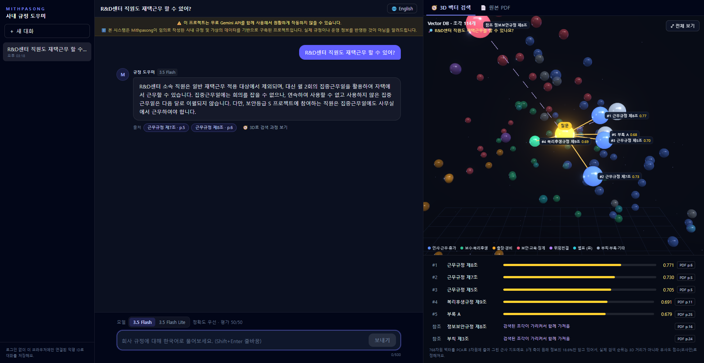
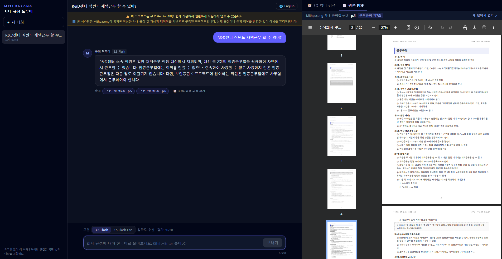
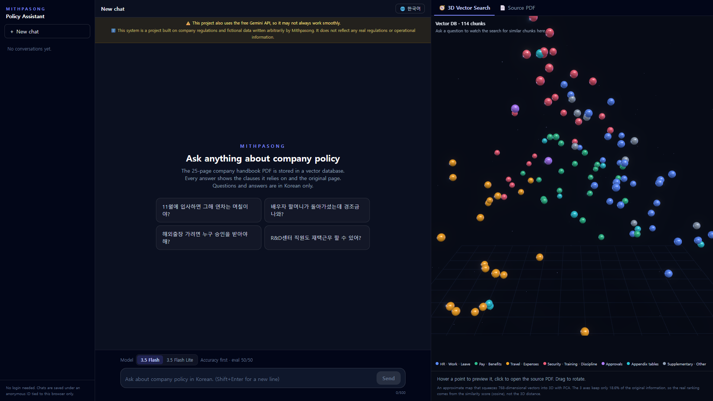
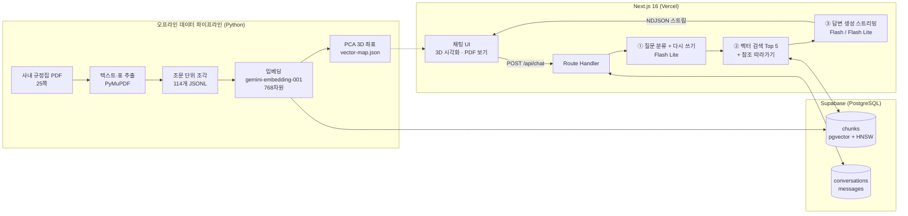

# 🧭 Visualizer LLM RAG — Company Policy

**사내 규정집 PDF를 Vector DB로 검색해 근거 조문과 함께 답하고, 그 검색 과정을 3D로 보여주는 RAG 챗봇**


> ℹ️ 본 시스템은 Mithpasong이 임의로 작성한 사내 규정 및 가상의 데이터를 기반으로 구축된 프로젝트입니다. 실제 규정이나 운영 정보를 반영한 것이 아님을 알려드립니다.



---

## 📌 한눈에 보기

| | |
|---|---|
| **무엇을** | 가상의 IT 회사 "Mithpasong"의 25쪽짜리 사내 규정집에 대해 질문하면, 관련 조문을 찾아 근거와 함께 답해요 |
| **어떻게** | PDF → 텍스트·표 추출 → 조문 단위 조각 114개 → 임베딩(768차원) → Supabase pgvector → 검색 → Gemini 답변 |
| **보여주는 것** | 질문 벡터가 어떤 문서 조각과 가까운지 **3D 공간에서 선으로 연결**해 보여주고, 출처를 누르면 **원본 PDF의 해당 페이지**가 열려요 |
| **검증** | 정답이 정해진 **테스트 질문 50개**로 검색과 답변을 채점했어요. 개선을 거쳐 **Gemini 3.5 Flash 50/50 (100%)** |

## ✨ 주요 기능

- **근거 있는 답변**: 답변 끝에 `출처: 휴가규정 제2조, 별표 1`처럼 조문을 표시하고, 출처 칩을 누르면 원본 PDF가 그 페이지로 열려요.
- **3D 벡터 검색 시각화**: 768차원 벡터를 PCA로 3차원에 그려요. 질문(노란 점)에서 검색된 조각으로 선이 뻗어 나가고, 유사도 점수를 함께 보여줘요. "⤢ 전체 보기"로 원래 시점으로 돌아갈 수 있어요.
- **참조 따라가기**: 검색된 조문이 "별표 9에 따른다"처럼 다른 자료를 가리키면, 그 자료도 자동으로 가져와요. (3D에서는 점선)
- **대화 기억**: 대화를 Supabase에 저장해요. "그럼 반차는?" 같은 후속 질문은 앞 대화를 반영해 완전한 질문으로 다시 써서 검색해요.
- **규정 외 질문 자동 거절**: 질문 분류기가 규정과 무관한 요청(코딩, 날씨, 잡담 등)을 검색 전에 걸러내요.
- **모델 선택**: Gemini 3.5 Flash(정확도 우선)와 Flash Lite(속도 우선) 중 골라서 물어볼 수 있어요.
- **한국어/영어 화면**: 화면 언어는 한국어·영어를 지원해요. 질문과 답변은 한국어로만 해요.
- **사용량 보호**: 로그인 없이 브라우저별 익명 ID로 대화를 구분하고, 하루 질문 수를 제한해요.

## 🖼️ 화면

| 출처를 누르면 원본 PDF의 해당 페이지가 열려요 | 영어 화면 |
|---|---|
|  |  |

---

## 🏗️ 아키텍처



### 질문 하나가 처리되는 과정

```
"그럼 반차는?"  (앞 대화: "CX센터 직원은 연차를 며칠 전에 신청해야 해?")
   │
   ▼ ① 질문 분류 + 다시 쓰기 (Flash Lite, JSON 응답)
   │    category: regulation
   │    standalone_question: "CX센터 직원은 반차를 며칠 전에 신청해야 해?"
   │    → greeting / off_topic 이면 여기서 정해진 안내로 끝
   │
   ▼ ② 검색
   │    질문 임베딩(RETRIEVAL_QUERY) → match_chunks() 코사인 유사도 Top 5
   │    상위 3개 조각에 "별표 N", "OO규정 제N조"가 있으면 최대 3개 추가로 가져옴
   │    질문 벡터를 PCA로 3D 좌표로 바꿔 화면에 전송
   │
   ▼ ③ 답변 (스트리밍)
   │    시스템 지시문 + 이전 대화 4턴 + [참고 자료] + 질문 → Gemini
   │    "규정 내용은 자료만 근거로", "모르면 모른다고", "출처 줄 필수" 등 10개 규칙
   │
   ▼ ④ 저장
        messages 테이블에 답변, 모델, 검색 결과(3D 좌표 포함) 저장
```

화면과 서버는 한 줄에 이벤트 하나씩 보내는 **NDJSON 스트림**으로 통신해요. `conversation` → `meta`(검색 결과, 3D 좌표) → `delta`(답변 조각) → `done` 순서라서, 답변 글자가 나오기 전에 3D 검색 애니메이션이 먼저 시작돼요.

---

## 📄 데이터 파이프라인: PDF에서 조각까지

규정집은 일부러 **RAG가 어려워하는 함정**을 넣어 만들었어요. ([원본 HTML](handbook/mithpasong-handbook.html) → Chrome으로 PDF 출력)

| 함정 | 예시 |
|---|---|
| 상식과 다른 규칙 | 입사 1년 미만도 매년 1월 1일에 연차 20일 |
| 같은 조문 번호 | 「휴가규정 제5조」와 「복리후생규정 제5조」는 전혀 다른 내용 |
| 다른 조항 참조 | "결재권자는 별표 9에 따른다" |
| 부서별 예외 | 재택근무는 주 2일, R&D센터는 집중근무일, CX센터는 불가 |
| 비슷한 용어 | 배우자 조부모 사망: 경조휴가 3일은 있지만 경조금은 없음 |
| 개정 전후 값 | 신구조문 대비표에 효력 없는 옛 값(연차 이월 10일)이 남아 있음 |
| 페이지에 걸친 표 | 위임전결표가 두 쪽에 걸쳐 있고 두 번째 쪽엔 제목 줄이 없음 |
| 규정에 없는 내용 | 주차, 어린이집, 기숙사 |

[`scripts/build_chunks.py`](scripts/build_chunks.py)는 **HTML 원본이 아니라 PDF만** 읽어서 조각을 만들어요. 실제 PDF에서 생기는 문제를 이렇게 해결했어요.

| 문제 | 해결 |
|---|---|
| 머리말, 쪽 번호가 본문에 섞임 | 페이지 위아래 영역의 글자를 버림 |
| 줄바꿈으로 문장이 쪼개짐 | 줄 간격(문단 안 16.5pt, 문단 사이 18.8pt 이상)으로 같은 문단인지 판단 |
| 글자 크기로 구조 파악 | 17pt 편 제목, 14pt 규정명, 10pt 굵은 글씨 + `제N조(` 패턴은 조문 |
| 두 페이지에 걸친 표 | 다음 쪽 맨 위의 같은 칸 수 표를 앞 표에 이어 붙이고, 제목 줄이 없으면 앞 표의 제목 줄을 씀 |
| 세로 병합 칸 | 빈칸을 위 값으로 채움 (`구분: 사망`) |
| 가로 병합 칸 | 병합 칸(`None`)과 진짜 빈칸(`''`)을 구분 |
| 표를 그대로 넣으면 의미가 깨짐 | 행마다 `등급: 가 \| 국가 및 지역: 미국, …` 문장으로 바꿈 |
| "제5조"만으로는 어느 규정인지 모름 | 모든 조각 앞에 `[문서명] 규정명 제N조(제목)` 머리말을 붙임 |

결과: **25쪽 → 조각 114개** (평균 222자). 조각마다 `ref`(예: `휴가규정 제2조`), 페이지, 규정명을 메타데이터로 저장해요.

---

## 📊 평가: 테스트 질문 50개

규정을 직접 만들었기 때문에 **정답을 알고 있어요.** 그래서 정답이 정해진 질문 50개([`data/eval/questions.jsonl`](data/eval/questions.jsonl))로 성능을 숫자로 쟀어요.

| 종류 | 개수 | 확인하는 것 |
|---|---|---|
| 기본 사실 | 5 | 기본 검색 |
| 계산 | 6 | 규정을 찾아서 숫자 계산 (예: 11월 입사자의 연차 3.5일) |
| 여러 조항 연결 | 5 | 두 군데 이상의 조각을 합쳐서 답하기 |
| 부서/조건별 예외 | 8 | 예외를 놓치지 않기 |
| 비슷한 용어 | 4 | 경조휴가와 경조금 구분 |
| 표 | 6 | 흩어진 표 읽기 (예: 베트남은 표에 없어서 "그 밖의 국가"로 판단) |
| 개정 전후 | 4 | 옛 값, 시행 예정 값으로 답하지 않기 |
| 같은 조문 번호 | 2 | 규정 이름까지 구분 |
| 상식과 다름 | 5 | LLM의 일반 지식 대신 문서를 따르기 |
| 규정에 없음 | 5 | 지어내지 않고 "찾을 수 없다"고 답하기 |

### 검색 채점 ([`scripts/eval_retrieval.py`](scripts/eval_retrieval.py))

정답 근거 조문이 검색 결과 상위 k개 안에 있는지 봤어요. (규정에 없는 질문 5개 제외, 45개)

| Hit@1 | Hit@3 | Hit@5 | All@5 |
|---|---|---|---|
| 96% | 100% | 100% | 98% |

### 답변 채점 ([`scripts/eval_answers.py`](scripts/eval_answers.py))

모범 답안의 핵심 키워드가 답변에 있는지, 규정에 없는 질문엔 거절했는지 채점했어요.

| 단계 | 변경 | Flash Lite | Flash |
|---|---|---|---|
| v1 | 기본 RAG (Top 5 검색 + 프롬프트) | 45/50 (90%) | - |
| v1' | **채점기 개선**: "40,000원 = 4만원", "20영업일 = 20일" 인정 | 47/50 (94%) | - |
| v2 | **참조 따라가기** + **프롬프트 조정** | 47/50 (94%) | **50/50 (100%)** |

**개선 과정에서 배운 것**

1. **채점기도 검증해야 한다**: 처음 오답 5개 중 2개는 사실 정답이었어요. 답변이 "40,000원"이라고 했는데 키워드가 "4만"이었어요.
2. **참조 따라가기**: "해외출장은 누가 승인해?"에서 검색은 `출장 및 여비규정 제3조`("별표 9에 따른다")만 찾아왔어요. 그래서 답이 "별표 9에 따릅니다"에서 멈췄어요. 검색된 조각이 가리키는 별표를 함께 가져오게 해서 해결했어요. (여러 조항 연결 80% → 100%)
3. **프롬프트가 너무 엄격해도 문제**: "일반 상식으로 보충하지 말라"고 했더니 **"부산은 광역시"라는 당연한 사실까지** 안 쓰고 숙박비를 틀렸어요. "규정 내용은 자료만, 지명 같은 일반 사실은 상식 허용"으로 다듬었어요.
4. **모델 차이**: 같은 검색과 프롬프트에서 Flash Lite는 표의 **엉뚱한 직급 행**을 읽는 실수가 남았고, Flash는 맞혔어요. Flash Lite는 질문당 약 2초, Flash는 약 8초가 걸렸어요(대략적인 값).

> ⚠️ 문서가 25쪽으로 작고 문서와 질문을 같은 사람이 만들었어요. 그래서 100%는 "완벽하다"보다 **"이 시험지로는 더 이상 약점이 보이지 않는다"**에 가까워요. 키워드 채점은 표현 차이에 약해서, 다음 단계로 LLM 채점을 고려하고 있어요.

---

## 🛠️ 기술 스택

| 영역 | 기술 |
|---|---|
| 웹 | Next.js 16 (App Router, Route Handlers), React 19, TypeScript, Tailwind CSS 4 |
| 3D | three.js, React Three Fiber, drei, postprocessing (Bloom) |
| Vector DB | Supabase PostgreSQL + pgvector (HNSW 인덱스, 코사인 거리) |
| LLM | Gemini 3.5 Flash / Flash Lite (답변), Flash Lite (질문 분류) |
| 임베딩 | `gemini-embedding-001`, 768차원, 문서는 `RETRIEVAL_DOCUMENT` · 질문은 `RETRIEVAL_QUERY` |
| 데이터 파이프라인 | Python 3.13, PyMuPDF, NumPy (PCA) — 표준 라이브러리로 API 호출 |
| 보안 | Supabase RLS + 서버 전용 Secret key, 브라우저별 일일 질문 수 제한 |

## 📁 폴더 구조

```
.
├─ handbook/                 규정집 원본 HTML (PDF의 원본이자 평가 정답 기준)
├─ data/
│  ├─ raw/                   mithpasong-handbook.pdf
│  ├─ processed/             chunks.jsonl (조각 114개), handbook.md (추출 결과 확인용)
│  └─ eval/                  questions.jsonl (테스트 50문제), 채점 결과, history/ (버전별 결과)
├─ scripts/                  Python 데이터 파이프라인과 평가
│  ├─ build_chunks.py        PDF → 조각 JSONL
│  ├─ ingest.py              조각 → 임베딩 → Supabase
│  ├─ build_vector_map.py    벡터 → PCA 3D 좌표 (web/public/vector-map.json)
│  ├─ search.py · answer.py  터미널에서 검색·답변 해보기
│  ├─ eval_retrieval.py      검색 채점
│  ├─ eval_answers.py        답변 채점 (--regrade: API 호출 없이 다시 채점)
│  └─ rag_common.py          Gemini·Supabase 호출 공통 모듈
├─ supabase/
│  ├─ schema.sql             chunks 테이블, HNSW 인덱스, match_chunks() 검색 함수
│  └─ chat_schema.sql        conversations, messages 테이블
├─ web/                      Next.js 앱
│  └─ src/
│     ├─ app/api/            chat (스트리밍), conversations
│     ├─ lib/                rag.ts, gemini.ts, db.ts, i18n.ts …
│     └─ components/         ChatApp, VectorScene (3D), PdfPanel …
└─ docs/screenshots/
```

---

## 🚀 직접 실행하기

### 1. 준비물

- Node.js 22 이상, Python 3.10 이상
- [Supabase](https://supabase.com) 프로젝트 (무료 플랜 가능)
- [Google AI Studio](https://aistudio.google.com) Gemini API 키

### 2. Supabase 테이블 만들기

Supabase 대시보드 → **SQL Editor**에서 두 파일을 차례로 실행해요.

1. [`supabase/schema.sql`](supabase/schema.sql): 벡터 조각 테이블과 검색 함수
2. [`supabase/chat_schema.sql`](supabase/chat_schema.sql): 대화 저장 테이블

### 3. 데이터 넣기 (Python)

```bash
pip install -r requirements.txt
cp .env.example .env               # SUPABASE_URL, SUPABASE_SECRET_KEY, GEMINI_API_KEY 채우기

python scripts/build_chunks.py     # PDF → data/processed/chunks.jsonl
python scripts/ingest.py           # 임베딩 → Supabase (다시 실행해도 안전)
python scripts/build_vector_map.py # 3D 좌표 → web/public/vector-map.json

# (선택) 터미널에서 해보기와 평가
python scripts/answer.py "11월에 입사하면 그해 연차는 며칠이야?"
python scripts/eval_retrieval.py
python scripts/eval_answers.py
```

### 4. 웹 앱 실행

```bash
cd web
cp .env.example .env.local         # 같은 키 + DAILY_MESSAGE_LIMIT
npm install
npm run dev                        # http://localhost:3000
```

### 환경변수

| 이름 | 설명 |
|---|---|
| `SUPABASE_URL` | Supabase 프로젝트 주소 |
| `SUPABASE_SECRET_KEY` | Supabase Secret key (`sb_secret_…`). **서버에서만** 사용 |
| `GEMINI_API_KEY` | Gemini API 키 |
| `DAILY_MESSAGE_LIMIT` | (웹, 선택) 브라우저당 24시간 질문 수 제한. 기본 30 |

---

## 🤔 설계 결정과 알려진 한계

- **3D는 근사 지도예요.** PCA 3개 축이 원래 정보의 약 18.6%만 담고 있어요. 실제 검색 순위는 3D 거리가 아니라 768차원 코사인 유사도로 정해지고, 화면에도 이 점을 밝혀 두었어요. (질문 벡터를 같은 공간에 바로 찍을 수 있어서 UMAP 대신 선형인 PCA를 골랐어요.)
- **Vector DB에는 조문만, 숫자 계산은 LLM이.** 현재 계산 질문은 LLM이 규정의 공식을 읽고 계산해요. 계산이 복잡해지면 계산 도구(함수 호출)로 분리하는 게 맞아요.
- **PDF 띄어쓰기 일부 손실.** 한글이 글자 단위로 줄바꿈되어 PDF에 줄 끝 공백 정보가 없어요. 그래서 "직원도 같다"가 "직원도같다"처럼 붙는 경우가 있어요. 임베딩 검색에는 영향이 작아서 그대로 두었어요.
- **로그인 대신 익명 ID.** 브라우저마다 만든 UUID로 대화를 구분해요. 같은 브라우저에서만 대화가 보여요.
- **무료 API 한도.** 이 프로젝트는 무료 Gemini API를 함께 사용해서 사용량이 많으면 원활하게 작동하지 않을 수 있어요.

## 📜 고지

이 저장소의 사내 규정집, 회사 이름, 조직, 수치는 모두 **가상**이에요. 실제 회사의 규정이나 운영 정보를 반영하지 않아요.
